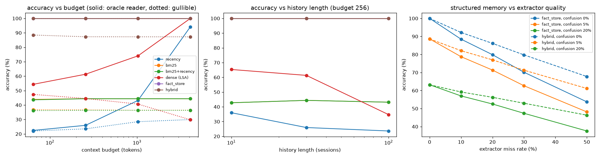

# agent-memory-bench

**Long-term memory for LLM agents, measured.** This repo compares the memory designs teams actually ship:
- a recency window,
- BM25 retrieval,
- embedding retrieval,
- a structured fact store with supersession,
- a hybrid of the fact store and retrieval.

They run on a reproducible multi-session benchmark with **knowledge updates**, **temporal questions**, **absent facts** and **hard distractors**. The main question is the one you face when you deploy one of these: *how good does the fact extractor have to be before structured memory wins?*

```
pip install -e ".[dev,plots]"
membench --users 50 --seeds 0 1 2 --out results     # ~5 min on CPU
```

## Benchmark

Each simulated user talks to an assistant over N sessions (30 by default; about 540 turns and 3k words). They state about 7 personal facts (city, employer, manager, diet, ...). About 4 of those get **updated** later, and the rest of the conversation is filler. 15% of user turns are **hard distractors** that mention a valid value about *someone else*, such as "My sister just moved to Berlin."

Questions are paraphrased away from the statements ("Which city am I based in?" vs "Home is Pune now"). They come in four types:

| type | asks for | why it's hard |
|---|---|---|
| `current` | a fact stated once | may be 30 sessions back |
| `updated` | the latest of several values | stale values compete |
| `previous` | the value *before* the latest | needs the value history |
| `absent` | a fact never stated | correct answer is "I don't know"; distractors tempt |

### Readers: bracketing the LLM

To separate *memory quality* from *reader quality*, every context is graded by two deterministic readers:
- The **oracle reader** trusts only true user statements. It is an upper bound.
- The **gullible reader** also believes distractor mentions. It is a lower bound.

A real LLM reader lands between the two. `membench/llm.py` has a Claude extractor and reader to place a real model there; they aren't run in these results, which use no API key.

### Strategies

| strategy | write path | read path |
|---|---|---|
| `recency` | — | last N tokens of transcript |
| `bm25` | index turns | BM25 top-k |
| `bm25+recency` | index turns | BM25 candidates + recency bonus |
| `dense (LSA)` | embed turns | cosine top-k. TF-IDF → SVD is a CPU stand-in for a neural embedder |
| `fact_store` | extract `(attr, value)` records; a new value **supersedes** the old one but keeps its history | route the question to attributes (top-2; 420/420 correct on a 30-user check), render the records |
| `hybrid` | both | fact records first, BM25+recency fills the rest of the budget |

The fact store's extractor is **simulated with controllable error**:
- *miss rate*: true statements dropped;
- *confusion rate*: distractor mentions recorded as user facts.

This is what makes the extractor-quality sweep possible.

## Results

Mean over 3 seeds × 50 users (about 2,000 questions per cell). Full tables are in [`results/results.md`](results/results.md).



### 1. Structured memory: 100% at 17 tokens, *with a perfect extractor*

| strategy | budget | accuracy (oracle) | accuracy (gullible) | context tokens |
|---|---|---|---|---|
| recency | 256 | 26.0% | 23.5% | 252 |
| recency | 4096 | 94.2% | 30.0% | 4092 |
| bm25 | 256 | 44.4% | 36.7% | 48 |
| dense (LSA) | 256 | 61.3% | 44.5% | 254 |
| dense (LSA) | 4096 | 100.0% | 29.8% | 3559 |
| fact_store (perfect extractor) | 256 | 100.0% | 100.0% | **17** |
| hybrid (perfect extractor) | 256 | 100.0% | 87.3% | 64 |

### 2. More context makes a gullible reader *worse*

- With 4k tokens, recency and dense retrieval contain every answer: the oracle reader scores 94–100%.
- The same contexts also contain every distractor, so the gullible reader falls to **30%**, and to **0.7–1.3% on `absent` questions**.
- **Stuffing the window is not a memory strategy** unless the reader reliably tells "my sister moved to Berlin" apart from "I moved to Berlin".
- The fact store resolves *who* a fact is about at write time, so it is immune (with a correct extractor).

### 3. Lexical retrieval hits a ceiling; dense retrieval decays with history length

- BM25 is stuck at **44%** whatever the budget. Paraphrased questions share almost no terms with the statements, and only about 60 tokens ever score above zero.
- LSA dense retrieval does better at short histories (65% at 10 sessions). At a fixed 256-token budget it **falls to 35% at 100 sessions**, because more look-alike turns compete for the same slots.
- The recency bonus didn't help BM25 at all. The bottleneck is recall, not ranking.

### 4. Extractor *confusion* is far more damaging than extractor *misses*

Fact-store accuracy (budget 256):

| | miss 0% | miss 10% | miss 30% | miss 50% |
|---|---|---|---|---|
| **confusion 0%** | 100.0 | 88.5 | 70.1 | 53.7 |
| **confusion 5%** | 88.6 | 78.8 | 62.7 | 48.1 |
| **confusion 20%** | 63.2 | 57.0 | 47.4 | 37.6 |

- **5% confusion costs as much as 10% misses** (88.6 vs 88.5).
- 20% confusion (63.2) is worse than 30% misses (70.1).
- A false record **supersedes** the true value and invents answers to `absent` questions: those drop to 74.9% at 5% confusion and 37.1% at 20%.
- Supersession is what makes structured memory precise, and it is also what makes a single wrong write silently overwrite the truth.

### 5. A hybrid recovers misses but cannot undo confusions

| miss rate | fact_store | hybrid | Δ |
|---|---|---|---|
| 10% | 88.5 | 92.2 | +3.7 |
| 30% | 70.1 | 79.8 | +9.7 |
| 50% | 53.7 | 67.8 | +14.1 |

- When the extractor drops a statement, the retrieved raw turns still carry it.
- At 0% misses, the hybrid and the pure store are **identical at every confusion rate**. Retrieved turns can't outvote a wrong record that is newer.

### Design implications

1. If your extractor is good, use structured memory with supersession. It is about 15× cheaper in context than retrieval and robust to distractors.
2. **Spend extractor effort on subject attribution (precision) before recall.** A miss is recoverable by a retrieval fallback; a confused write is not. Validate writes before they supersede: for example, require first-person attribution, keep conflicting values as *contested* instead of overwriting, and ask the user to confirm.
3. Add a retrieval fallback (hybrid) to absorb extraction misses.
4. Long context plus a recency window works only when the reader is robust to distractors, and you pay for it on every call.

## Limitations

- The data is synthetic and template-based. It isolates the mechanisms (updates, distractors, paraphrase) but is easier than real conversations: facts are single-valued, there is no coreference, and there are no implicit facts.
- The LSA embedder is weaker than modern neural embedders. It is used here to keep the benchmark offline and deterministic, so the dense numbers are a floor.
- The readers are deterministic bounds, not an LLM. Use `llm.py` to measure a real model.

## Layout

| file | what |
|---|---|
| `src/membench/synth.py` | history and question generator with ground-truth annotations |
| `src/membench/memory.py` | the six strategies, BM25, LSA embedder, attribute router, simulated extractor |
| `src/membench/evaluate.py` | oracle/gullible readers, evidence recall, bootstrap CIs |
| `src/membench/llm.py` | Claude extractor and reader (optional) |
| `src/membench/cli.py` | the three sweeps; writes `results/` |
